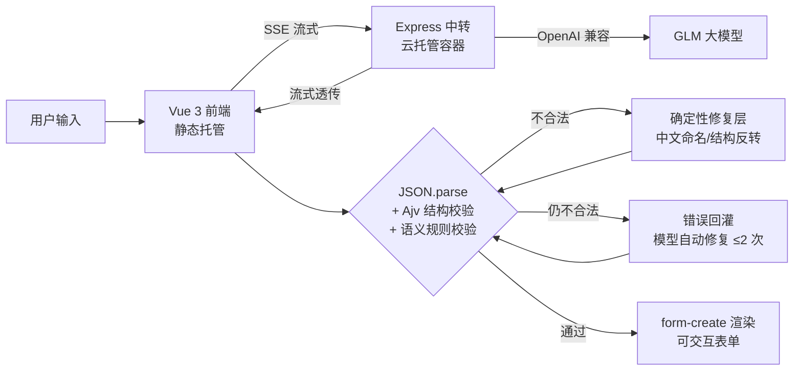

# AI 表单生成器

用一句自然语言，流式生成**可交互的中后台表单**——实时打字机输出、JSON Schema 双层校验、失败自动修复，生成结果可一键导出为 [form-create](https://github.com/xaboy/form-create) 原生规则，直接用于任何 Vue 3 + Element Plus 项目。

**在线体验**：<https://medicine-d6gds389qecfc4c6a-1304975205.tcloudbaseapp.com/ai-form/>
（腾讯 CloudBase 测试域名，首次访问需点击「确定访问」通过官方风险提示页）

<!-- TODO: 录制后放 GIF：assets/demo.gif -->

## 它能做什么

- 💬 **对话式生成**：一句话描述业务需求，左侧流式输出配置、右侧实时渲染表单
- 🔁 **多轮修改**：「加一个附件字段」「把请假类型改成必填」，基于当前 schema 增量修改
- 🛑 **流式可控**：打字机效果实时呈现，生成中可随时中断
- 📋 **一键落地**：导出 form-create 原生 rules，粘贴进项目即可用
- 🔑 **BYOK 双模式**：访客可填自己的 API Key（仅存本地浏览器），不填则使用站点内置额度
- 🛡️ **生产级细节**：限流防刷、冷启动自动重试、隐私声明、中文本地化、移动端适配

## 架构



**为什么不做成"AI 直接生成页面代码"？** 生成的是**结构化 schema（配置资产）**而不是一次性代码：风格由组件库主题保证（AI 永远不写 CSS）、可转换适配任意组件库、可导出为 form-create 规则直接落地。这是「配置驱动」架构在 AI 时代的价值。

## 技术要点

| 模块 | 实现 |
|---|---|
| 流式 | fetch + ReadableStream 手写 SSE 分帧解析（TCP 分包截断缓冲）；AbortController 全链路中断 |
| 结构化输出 | JSON mode（不支持时降级）+ JSON 容错提取 + Ajv 结构校验 + 语义规则校验 |
| 容错三层 | ① 确定性修复层：中文字段名/结构反转/引用错位，代码直接修，不浪费模型重试；② 错误转中文回灌，模型自动修复 ≤2 次；③ 修复失败降级展示原始输出 |
| 密钥安全 | Key 只存服务端环境变量；BYOK 模式存访客本地 localStorage，请求头透传，服务端不留存 |
| 防刷 | 每 IP 每分钟 5 次限流 + 请求体大小限制 + 容器缩容到零（闲时零成本） |
| 冷启动 | 缩容后首个请求自动重试（3s/8s 退避）+ 友好唤醒提示 |

## 踩坑记录（生产环境真实排障）

1. **云托管网关缓冲 SSE**：中转服务本地流式正常，经平台默认域名后被整体缓冲。定位方式：对上游、本地中转、线上链路分别做**时钟级分块测试**（记录每个 chunk 到达时间），确认缓冲发生在网关层，通过规范 SSE 响应头解决。
2. **Node ≥16 的 `req 'close'` 语义变化**：请求体读完即触发 close，中断监听挂错位置导致上游未连接就被 abort，返回 200 空响应。修复：挂载到 `res` 并排除正常结束。
3. **弱模型结构性输出错误**：glm-4-flash 会把 `groups.fields`（应为字符串数组）写成完整对象、field 用中文命名。纯提示词修复不稳定，最终方案是**确定性修复层 + 模型重试**双层容错——能用代码修的不浪费模型调用。
4. **Vue 3 响应式陷阱**：流式更新直接赋值原始对象引用不触发重渲染，表现为"生成过程静止、结果一次性蹦出"。修复：`reactive()` 包裹消息对象。排障链路：HTTP 时钟测试排除网关 → 三方对照 → 页面内量化采样定位渲染层。
5. **远端构建机 npm install 不稳定**：Docker 远端构建 7 分半后 npm 崩溃（`Exit handler never called`），镜像依赖不完整导致容器崩溃循环。最终方案：esbuild 打单文件（1.1MB 内联 express），构建时间 8 分钟 → 40 秒。
6. **system prompt 超 body 限制**：中文 UTF-8 下完整规范摘要远超 2KB，触发 express 413。限制值按实际 payload 设计，不拍脑袋。

## 快速开始

```bash
# 前端
pnpm install
cp .env.local.example .env.local   # 填入你的 LLM_* 三变量
pnpm dev                            # http://localhost:5199

# 中转服务（另开终端）
cd server && npm install
node --env-file=../.env.local index.js   # http://localhost:8787
```

环境变量（模型无关，换模型只改这三个值）：

```
LLM_BASE_URL=https://open.bigmodel.cn/api/paas/v4   # 或 DeepSeek 等任意 OpenAI 兼容端点
LLM_API_KEY=your-key
LLM_MODEL=glm-4-flash
```

## 部署

前端 → CloudBase 静态托管；中转 → CloudBase 云托管容器（`server/Dockerfile`，缩容到零）。
构建产物：`pnpm bundle` 生成单文件（esbuild 内联依赖），远端构建无需 npm install。
线上一键切换模型/供应商：只改容器环境变量三个值。

## Roadmap

- [ ] 列表页 scene（搜索表单 + 表格列配置生成）
- [ ] 详情页 scene（只读字段分组展示）
- [ ] **Agent 化**：Function Calling + 工具循环（validate / 查规范 / 读当前 schema），从 workflow 升级为 agent，支持「生成表单 + 配套审批流」多步任务
- [ ] 生成历史本地持久化

## License

MIT
